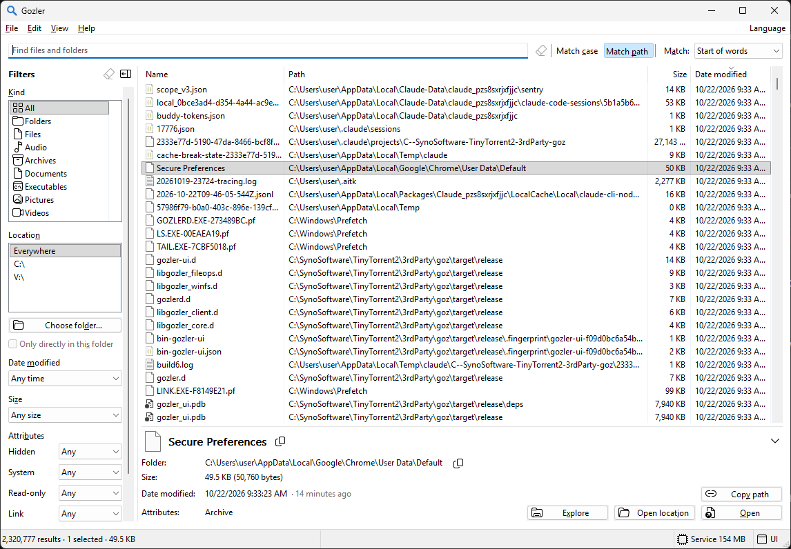
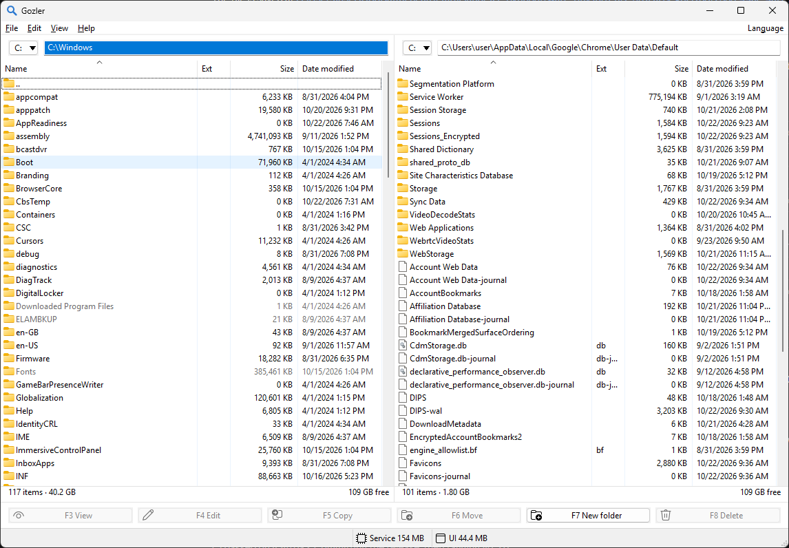
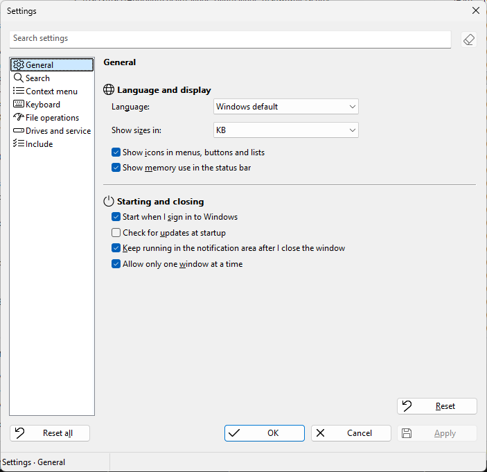
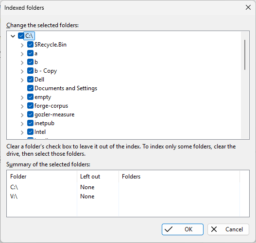

# Gozler

[](https://github.com/SynoSoftware/gozler/actions/workflows/ci.yml)
[](LICENSE)

**Find files instantly. Copy, move and delete them blazingly fast.**

Free and open source, for Windows 10 and 11.

- *Instant file search across NTFS and ReFS drives, inspired by voidtools Everything.*
- *Copy engine inspired by [FastCopy and AngelCOPY](docs/research/fast-copy-delete.md#copiers),
  but faster (Gozler's SSD scheduling cut mixed-file copy time even further
  by [17% in our test](docs/BENCHMARKS.md#ssd-early-dispatch-before-and-after)).*
- *[Folder synchronization](docs/DESIGN.md#synchronize-folders) inspired by
  Robocopy: preview changes before copying, with optional mirroring.*
- *Deletion inspired by [rmbrr](docs/research/fast-copy-delete.md#rmbrr).*
- *UI inspired by Norton Commander, with two panels for convenient copy,
  move and delete.*

Search your Windows drives, then act on what you find. Copy, move or delete
directly from results, or use Commander mode's two panels to keep the source
and destination in view.

**[Download Gozler for Windows x64](https://github.com/SynoSoftware/gozler/releases/latest)**
· [What's new](https://github.com/SynoSoftware/gozler/releases)



## Find files across your drives

Search filenames across NTFS and ReFS drives as you type, including Dev
Drives and files reached through junctions and folder symbolic links. Narrow
results by folder, file type, size, date or attributes.
Combine terms, exclude names, or use regular expressions.

- **Go straight to its folder.** Press Enter on a result to show it in
  Commander, or run your chosen command. Ctrl+F searches from either panel.
- **Search by folder.** Match part of a folder path to find files below it,
  including files reached through a folder link.
- **Browse millions of results.** Scroll through the full list, sort it,
  or inspect a file's details. Press F3 to view a file as text or hex.
- **Use the results where you need them.** Copy paths, export to CSV, or
  drag files straight into another program.
- **See what takes up space.** Check folder sizes and item counts, or sort
  by size to find the largest folders and files. Folder sizes are available
  to users allowed to see every indexed file.
- **Big exports don't hold up other searches.** Keep searching while an
  export runs, even with millions of files in deeply nested folders.
- **Results stay current.** New files, changes and renames appear
  automatically, including hard-link renames. The status bar shows each
  drive's indexing progress and tells you when results may be incomplete.
- **Search respects folder permissions.** On a shared PC, each person sees
  the files in folders they can access. An administrator can choose users
  and groups that see every indexed file.

In our [path-search benchmark](docs/research/measurements/linked-path-search-2026-10-29.md),
a folder-path query used **74% fewer CPU cycles** than the previous search
engine: 308 million down to 82 million. The test used a synthetic index of
2.14 million entries and measured the core query engine; a full search also
includes service preparation, permission checks and communication.

## Fast copy, move and delete

Copy, move or delete what you find directly from search results. Totals
come from the index, so work can start without walking the whole tree to
count files first.
Commands in Search work on up to 100,000 selected results at a time.

- **Copy small files about 1.8 times faster than robocopy** in our
  [published copy tests](docs/BENCHMARKS.md#stage-e-final-names-and-resume).
- **Delete about 3 times faster than `rmdir`.** 30,000 files in 5,000 folders
  took **6.4 seconds instead of 19.1** in our
  [deletion test](docs/BENCHMARKS.md#copy-move-and-delete-engine).
- **Keep browsing while files transfer.** Check progress, pause, cancel or
  change the queue order in the File transfers pane. It keeps the current
  file, queue and reports together in the main window.
- **Put urgent transfers first.** Drag to reorder the queue or choose Run
  now. Transfers on independent disks can run together; work waiting for a
  busy disk does not hold up unrelated transfers.
- **Compare and synchronize folders.** Preview additions and updates before
  copying. Choose Mirror to permanently remove reviewed destination-only
  files after the required copies succeed.
- **Choose how to handle existing files.** Update changed or newer files,
  keep both, or skip them without repeated conflict questions. The default,
  Update changed files, can replace a newer destination file.
- **Continue after an interruption.** After a restart or crash, Gozler offers
  to continue copies, moves and deletes. A half-copied file resumes where it
  stopped.
- **Automatic or your choice.** Automatic adapts copying to the file size
  and drive type. Choose the Windows engine or Gozler's ring copy through
  the speed presets, or adjust the settings yourself.
- **Move within a drive in moments.** A move on the same volume uses a rename
  when possible, without copying the file's contents.

Deletes are permanent: Gozler does not use the Recycle Bin.

In a [mixed-file SSD test](docs/BENCHMARKS.md#ssd-early-dispatch-before-and-after),
starting large files alongside small ones reduced the median copy time from
**14.32 to 11.84 seconds**, including the final flush, compared with Gozler's
previous scheduling. The test copied 6,000 small files and one 1,600 MiB
file within one NVMe SSD. The [benchmark record](docs/BENCHMARKS.md#competitor-context)
also explains how that scheduling differs from AngelCOPY's.

## Keep source and destination side by side

Commander mode's two panels provide a familiar Norton Commander layout for
Gozler's fast file operations. Copy and Move suggest the other panel's folder
automatically. Folder changes appear live, and slow network folders load
without freezing the window.

Press **F5** to copy, **F6** to move, **F7** to create a folder, or **F8**
to delete. Use **Insert**, **Space** or **Shift** to select entries, or
Num + and Num − to select and clear by a mask such as `*.jpg;*.png`.
Press **Alt+F7** for Search, **Alt+F12** for Commander, and **Alt+Left**
to return to your search with its results and selection intact.



The built-in Text and Hex Viewer opens even multi-gigabyte files at once,
without blocking other programs from writing to, renaming or deleting them.
Press **F4** to switch between text and hex, and copy text with Ctrl+C.

## Coming in the next release

The current development version adds ordered word matching in the window:
with Start of words, `para 50 mg` finds `paracetamol extra 500 tablets.mg`.
It also shows concurrent jobs separately in the status bar, and lets you
choose whether Commander selection masks include folders. These changes are
not yet in the latest release.

## Recent releases

- **[0.5.7](https://github.com/SynoSoftware/gozler/releases/tag/v0.5.7):**
  Search through junctions and folder symbolic links, faster path searches,
  F3 Viewer in Search, and shortcuts to switch between Search and Commander.
- **[0.5.6](https://github.com/SynoSoftware/gozler/releases/tag/v0.5.6):**
  Less flicker, search that respects folder permissions, Total Commander-style
  selection, and selection by file mask.
- **[0.5.5](https://github.com/SynoSoftware/gozler/releases/tag/v0.5.5):**
  Faster mixed-file copying, folder synchronization, transfer scheduling,
  and the File transfers pane in the main window.
- **[0.5.0](https://github.com/SynoSoftware/gozler/releases/tag/v0.5.0):**
  Two-panel file management, the Text and Hex Viewer, and browsing millions
  of search results.

## Install and start searching

Download the installer from the
[latest release](https://github.com/SynoSoftware/gozler/releases/latest), run
it, and open Gozler from the Start menu. The installer sets up the search
service and upgrades an earlier Gozler installation.

- Windows 10 or 11, x64.
- Instant search indexes fixed NTFS and ReFS drives. Folder panels can also
  browse removable drives and network folders.
- Available in English, Spanish, Dutch and Turkish.

Choose the folders to index in Settings. If the service needs attention,
Gozler offers a repair action in the window. A ZIP download is also
available on the release page; keep all three programs from the same release
together.

<p>
  
  
</p>

## Search from scripts and terminals

Search from a terminal, or change `es.exe` to `gozler` in an existing
Everything script:

```
gozler report                       # filenames containing report
gozler "*.iso" -sort size -n 10      # the 10 largest ISO files
gozler --json report                # JSON for scripts and agents
gozler -export-csv files.csv ext:cs  # export matching files
```

The default is 20 results; `-n all` returns every match. Scripts and agents
can tell whether an answer is complete from its exit code. Invalid search
terms produce an error. Run `gozler -h` for quick examples or `gozler --help`
for the full reference.

## Performance records

[Benchmarks](docs/BENCHMARKS.md) record the tests behind the speed claims.
The original search and memory comparison with Everything was measured on
**goz v0.2.0**: searches were **1.8 to 6.1 times faster than Everything** in
those tests. Those figures describe that version. Later records cover copy
speed and [reduced memory use for deep-folder exports](docs/research/deep-folder-rows.md).

## Security

The search service indexes file names, sizes and dates with administrator
access, and shows each user only the names in folders that user can open,
except the users and groups an administrator lists to see every file.
File operations run with your own permissions. Read the
[security model](docs/SECURITY.md) for shared-PC use and reporting vulnerabilities.

## Build and contribute

[Build from source](docs/BUILDING.md) · [Design](docs/DESIGN.md) ·
[Report an issue](https://github.com/SynoSoftware/gozler/issues)

[Synapse N.V.](http://synapse.sr) develops Gozler at
[SynoSoftware/gozler](https://github.com/SynoSoftware/gozler).
It began as a fork of [goz v0.2.0](https://github.com/mustafaahci/goz)
by Mustafa Ahci, who created the original index, daemon and historical
benchmarks. Gozler means “eyes” in Turkish.

Licensed under the [MIT License](LICENSE).
